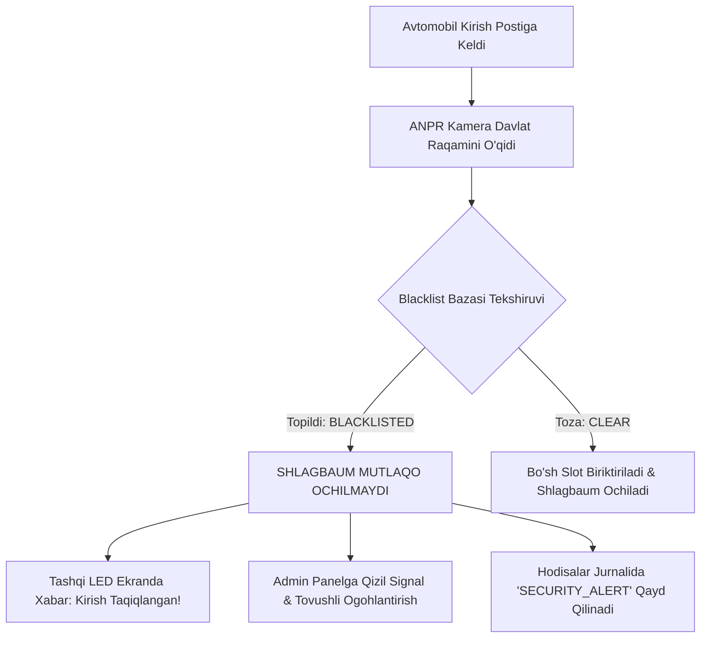

# 🚫 Parkly.uz — Avtomobillar Qora Ro'yxati (Blacklist) Siyosati va Texnik Protokoli

> **Hujjat Turi:** Texnik va Ma'muriy Qoidalar To'plami  
> **Versiya:** 2.12.0  
> **Til:** O'zbek tili  
> **Oxirgi yangilanish:** 2026-yil 29-oktabr  

---

## 📌 1. Qora Ro'yxatga (Blacklist) Kiritish Sabablari va Asoslari

Parkly.uz tizimida transport vositasining davlat raqami quyidagi 4 ta asosiy qoidabuzarlik yoki ma'muriy qaror asosida avtomatik yoki qo'lda qora ro'yxatga kiritiladi:

1. **To'lovdan bo'yin tovlash va Qarzlar (Payment Evasion):**
   - Avtoturargohdan ruxsatsiz chiqib ketish yoki to'lov qilmasdan qochishga urinish holatlari.
   - Soxta, qayta ishlatilgan yoki manipulyatsiya qilingan to'lov cheklari (Click/Payme/Uzum) taqdim etilganda (`payment_blacklist_filter.py` orqali aniqlanadi).
2. **Shlagbaum va Infratuzilmaga Shikast Yetkazish (Vandalism & Damage):**
   - Shlagbaum to'sig'iga (strelasiga), korpusiga, servo mexanizmiga, ANPR kamerasi yoki datchiklarga transport vositasi urilishi oqibatida zarar yetkazilishi.
3. **Tailgating (Ruxsatsiz ergashib kirish/chiqish):**
   - Oldindagi transport vositasi uchun shlagbaum ochilgan paytda uning ortidan yopishib (1.5 metrdan yaqin masofada) to'lovsiz yoki ro'yxatdan o'tmasdan kirish yoki chiqishga urinish.
4. **Administrator tomonidan Qo'lda Kiritish (Manual Admin Ban):**
   - Ichki xavfsizlik, shubhali harakatlar yoki ma'muriyatning rasmiy ko'rsatmasi bo'yicha tizim super-administratorlari (`dilshod_pm` yoki `mirhamid_be`) tomonidan sababi ko'rsatilgan holda kiritilgan transport vositalari.

---

## 🚨 2. Qora Ro'yxatdagi Transport Vositasi Kelganda Tizim Reaksiyasi

Qora ro'yxatga olingan avtomobil kirish postiga (ESP32-CAM ANPR zonasi) yaqinlashganda:



### Texnik Harakatlar Protokoli:
1. **Shlagbaum Blokirovkasi:** Shlagbaum servomotoriga `SERVO_CLOSED_DEG` (yopiq) buyrug'i saqlanadi, har qanday avtomatik ochilish buyruqlari bloklanadi.
2. **Haydovchini Ogohlantirish:** Postdagi tashqi LED tabloga quyidagi xabar chiqariladi:  
   `⛔ TIZIMGA KIRISH TAQIQLANGAN! ADMINISTRATORGA MUROJAAT QILING.`
3. **Admin Panelga Real-time Signal:** Supabase Realtime / WebSocket orqali navbatchi operator va super-administratorlar ekranida qizil miltillovchi banner paydo bo'ladi va favqulodda signal chalinadi:  
   `[DIQQAT] Qora ro'yxatdagi transport vositasi postda: 01A777AA (Sabab: To'lanmagan qarz / Shlagbaum shikasti)`.
4. **Foto va Video Arxivlash:** ESP32-CAM kadrni yuqori sifatda suratga olib, vaqt tamg'asi (timestamp) bilan `/storage/security_events/` papkasiga arxivlaydi.

---

## 🛠️ 3. Qora Ro'yxatdan Chiqarish (Unban) Tartibi

Transport vositasini qora ro'yxatdan chiqarish faqat quyidagi shartlar to'liq bajarilganda amalga oshiriladi:

1. **Qarz va Jarimani So'ndirish:**
   - Qoidabuzar yetkazilgan moddiy zararni (masalan, shlagbaum ta'mirlash xarajatlari) yoki avvalgi to'lanmagan to'xtash to'lovlarini to'liq to'lashi shart.
2. **Ma'muriy Tasdiq:**
   - Blokdan chiqarish huquqiga faqat **Super Admin** rollari (`dilshod_pm` va `mirhamid_be`) ega. Operator yoki oddiy adminlar qora ro'yxatdan chiqara olmaydi.
3. **Audit Jurnali:**
   - Har bir chiqarish amalioti tizim loglarida qachon, kim tomonidan va qaysi kvitansiya/asos bilan chiqarilgani ko'rsatilgan holda abadiy saqlanadi.

---

## 🗄️ 4. Ma'lumotlar Bazasi Tuzilmasi (PostgreSQL / Supabase Schema)

```sql
CREATE TABLE vehicle_blacklist (
    id UUID PRIMARY KEY DEFAULT gen_random_uuid(),
    plate_number VARCHAR(16) NOT NULL UNIQUE,
    reason VARCHAR(255) NOT NULL,
    category VARCHAR(32) NOT NULL, -- 'PAYMENT_EVASION', 'DAMAGE', 'TAILGATING', 'MANUAL_ADMIN'
    penalty_amount NUMERIC(12, 2) DEFAULT 0.00,
    added_by VARCHAR(64) NOT NULL, -- Mas'ul admin username
    is_active BOOLEAN DEFAULT TRUE,
    notes TEXT,
    created_at TIMESTAMP WITH TIME ZONE DEFAULT NOW(),
    unbanned_at TIMESTAMP WITH TIME ZONE,
    unbanned_by VARCHAR(64)
);

CREATE INDEX idx_blacklist_plate ON vehicle_blacklist(plate_number);
```
